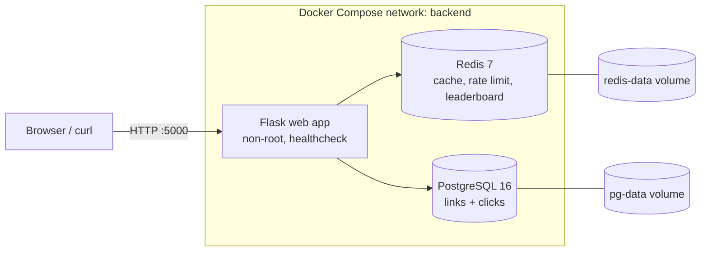

# Dockerized URL Shortener with Click Analytics


A production-shaped, three-tier URL shortener. **Flask** serves the API and a live dashboard, **Redis** handles caching, rate limiting and a real-time leaderboard, and **PostgreSQL** is the durable source of truth. The whole stack starts with one command.


> **Summary for reviewers:** multi-stage build, non-root container, healthchecks on every service, health-gated startup, persistent volumes, secrets kept out of Git, and a Redis layer that is deliberately designed so that losing the cache never loses data.

---

## Quick start

```bash
git clone https://github.com/rulesmaaz/shortly-docker.git
cd shortly-docker
cp .env.example .env            # then set DB_PASSWORD
docker compose up -d --build
docker compose ps               # wait until all three show (healthy)
```

Open **http://localhost:5000** for the dashboard.

Or skip the build and pull the prebuilt image:

```bash
docker pull rulesmaaz/shortly:1.0
```

**Requirements:** Docker 24+ with the Compose plugin. Nothing else is installed on your machine.

---

## Demo in 30 seconds

```bash
# 1. Shorten a URL
curl -s -X POST localhost:5000/shorten \
  -H 'Content-Type: application/json' \
  -d '{"url":"https://github.com/rulesmaaz"}'
# {"code":"aB3xK9z","short_url":"http://localhost:5000/aB3xK9z","url":"..."}

# 2. Follow it twice and watch the cache header change
curl -si localhost:5000/aB3xK9z | grep -E "HTTP|X-Cache"   # 302, X-Cache: MISS
curl -si localhost:5000/aB3xK9z | grep -E "HTTP|X-Cache"   # 302, X-Cache: HIT

# 3. See the analytics
curl -s localhost:5000/stats/aB3xK9z
```

---

## Architecture



| Component | Role | Pattern |
|---|---|---|
| Redis `link:{code}` | Caches the code → URL mapping used on every redirect | Cache-aside with a 300s TTL |
| Redis `rl:{ip}` | Rate limit on `POST /shorten` | Fixed-window `INCR` + `EXPIRE`, fails open |
| Redis `top_links` | Click leaderboard | Sorted set (`ZINCRBY` / `ZREVRANGE`) |
| PostgreSQL `links` | Canonical code → URL mapping | Durable source of truth, `UNIQUE` code |
| PostgreSQL `clicks` | One row per click (time, user agent, referrer) | Analytics and audit trail |

Only the Flask container is published to the host. Redis and PostgreSQL are reachable only inside the Compose network.

---

## API

| Method | Path | Description |
|---|---|---|
| `GET` | `/` | Dashboard with totals and top links |
| `POST` | `/shorten` | `{"url": "..."}` returns `{"code", "short_url", "url"}` (201). Rate limited (429) |
| `GET` | `/<code>` | 302 redirect to the target. Response includes `X-Cache: HIT` or `MISS` |
| `GET` | `/stats/<code>` | Total clicks, last click time, whether the link is cached |
| `DELETE` | `/links/<code>` | Deletes the link and its clicks, and invalidates the cache |
| `GET` | `/api/top` | Top 10 links, served from the Redis sorted set |
| `GET` | `/health` | 200 only if both Redis and PostgreSQL are reachable, otherwise 503 |

---

## DevOps practices demonstrated

| Practice | How it is done here |
|---|---|
| **Multi-stage build** | Compilers (`gcc`, `libpq-dev`) stay in the builder stage. The runtime image ships only `libpq5` and `curl` |
| **Non-root container** | The app runs as `appuser` (system user), not root |
| **Healthchecks on all services** | `curl /health` for Flask, `redis-cli ping` for Redis, `pg_isready` for PostgreSQL |
| **Health-gated startup** | `depends_on` with `condition: service_healthy`, so Flask never starts against an unready database |
| **Persistent storage** | Named volumes for PostgreSQL data and Redis (AOF enabled) |
| **Secrets out of Git** | Password lives in `.env` (ignored), template in `.env.example` |
| **Config via environment** | Cache TTL, rate limit, base URL and DB settings are all env vars |
| **Small build context** | `.dockerignore` excludes `.env`, `.git`, caches and docs |
| **Pinned base images** | `python:3.11-slim`, `postgres:16-alpine`, `redis:7-alpine` |
| **Restart policy** | `restart: unless-stopped` on every service |
| **Published image** | Versioned image on Docker Hub: `rulesmaaz/shortly:1.0` |

---

## Engineering decisions

**Redis is a cache. PostgreSQL is the truth.**
Clicks are written durably to PostgreSQL. If Redis is flushed or evicted, the app loses speed and the leaderboard, but no data. The dashboard's totals come from SQL; the `/api/top` leaderboard is a fast derived view.

**Cache-aside with a TTL.**
Redirects are the hot path. The mapping is read from Redis first and repopulated from PostgreSQL on a miss. The `X-Cache` header makes this behaviour observable instead of something to take on trust. The TTL bounds staleness and memory use.

**Explicit cache invalidation.**
`DELETE /links/<code>` removes the row, then deletes `link:{code}` and the leaderboard entry. Without this, a deleted link would keep redirecting until its TTL expired.

**Rate limiting lives in Redis, not in process memory.**
A per-IP counter in Redis stays correct when `web` is scaled to several replicas. An in-process counter would multiply the real limit by the replica count. The limiter **fails open**, so a Redis outage never becomes an API outage.

**Resilient connections.**
Redis and PostgreSQL connections retry at startup, and the database connection re-establishes itself if it drops. `/health` reports the state of each dependency separately.

**Defensive input handling.**
Only `http` and `https` URLs are accepted, with a length cap. Short codes come from `secrets` (cryptographically secure), avoid reserved route names, and collisions are retried against a `UNIQUE` constraint. All SQL is parameterized.

---

## Verify it yourself

<details>
<summary><b>Rate limiter</b></summary>

```bash
for i in $(seq 1 35); do
  curl -s -o /dev/null -w "%{http_code} " -X POST localhost:5000/shorten \
    -H 'Content-Type: application/json' -d "{\"url\":\"https://example.com/$i\"}"
done; echo
# 201 x30, then 429 x5. The window resets after 60 seconds.
```
</details>

<details>
<summary><b>Persistence</b></summary>

```bash
docker compose down        # containers removed, volumes kept
docker compose up -d
curl -s localhost:5000/stats/<code>    # click history is still there
```
</details>

<details>
<summary><b>Inspect Redis directly</b></summary>

```bash
docker compose exec redis redis-cli --scan --pattern 'link:*'
docker compose exec redis redis-cli zrevrange top_links 0 -1 withscores
```
</details>

<details>
<summary><b>Cache invalidation</b></summary>

```bash
curl -s -X DELETE localhost:5000/links/<code>
docker compose exec redis redis-cli exists link:<code>      # 0
docker compose exec redis redis-cli zscore top_links <code> # (nil)
```
</details>

---

## Configuration

| Variable | Default | Description |
|---|---|---|
| `DB_PASSWORD` | `postgres` | PostgreSQL password. **Set a strong value in `.env`** |
| `BASE_URL` | `http://localhost:5000` | Prefix used in generated short links |
| `CACHE_TTL` | `300` | Redis cache lifetime in seconds |
| `RATE_LIMIT` | `30` | Max `POST /shorten` calls per minute per IP |

---

## Project structure

```
shortly-docker/
├── app.py                # Flask app: routes, cache-aside, rate limiter, dashboard
├── requirements.txt      # Pinned Python dependencies
├── Dockerfile            # Multi-stage, non-root, with healthcheck
├── docker-compose.yml    # web + redis + db, volumes, network, health-gated startup
├── .env.example          # Config template (real .env is git-ignored)
├── .dockerignore
├── .gitignore
└── docs/
    └── dashboard.png     # Screenshot used in this README
```

---

## Known limitations and what I would do next

I would rather list these than hide them:

- [ ] **CI/CD:** GitHub Actions to lint, build, scan with Trivy, and push the image on every commit
- [ ] **Connection pooling:** replace the single shared PostgreSQL connection with a pool (for example `psycopg2.pool` or PgBouncer) and run under Gunicorn instead of the Flask dev server
- [ ] **Async click logging:** clicks are written synchronously today. At higher volume, push them to a Redis stream and batch-insert with a worker
- [ ] **Table maintenance:** partition `clicks` by month with a retention policy
- [ ] **Reverse proxy:** NGINX in front of Flask, on a separate network from the databases
- [ ] **Cloud deployment:** provision infrastructure with Terraform and run this stack on AWS
- [ ] **Abuse protection:** URL allow/block lists, since shorteners attract phishing

---

## What this project shows

- I can containerize a multi-service application end to end, not just run a single image.
- I think about failure modes: a cache outage, a slow database at startup, stale cache entries, and replicas sharing state.
- I make security basics the default: non-root user, no secrets in Git, minimal runtime image.
- I can explain trade-offs and name the limits of my own design.

---

## Author

**Maaz**
GitHub: [@rulesmaaz-spec](https://github.com/rulesmaaz-spec) · Docker Hub: [mohammad1maaz](https://hub.docker.com/repositories/mohammad1maaz)
LinkedIn: _add your link_ · Email: _add your email_

Built as part of my DevOps journey.

## License

MIT